# Mermaid Studio

Mermaid 코드를 편집하고 검증하는 한국어 다이어그램 스튜디오입니다. Vite 기반 브라우저 앱과 재사용 가능한 SVG 렌더러를 제공합니다.

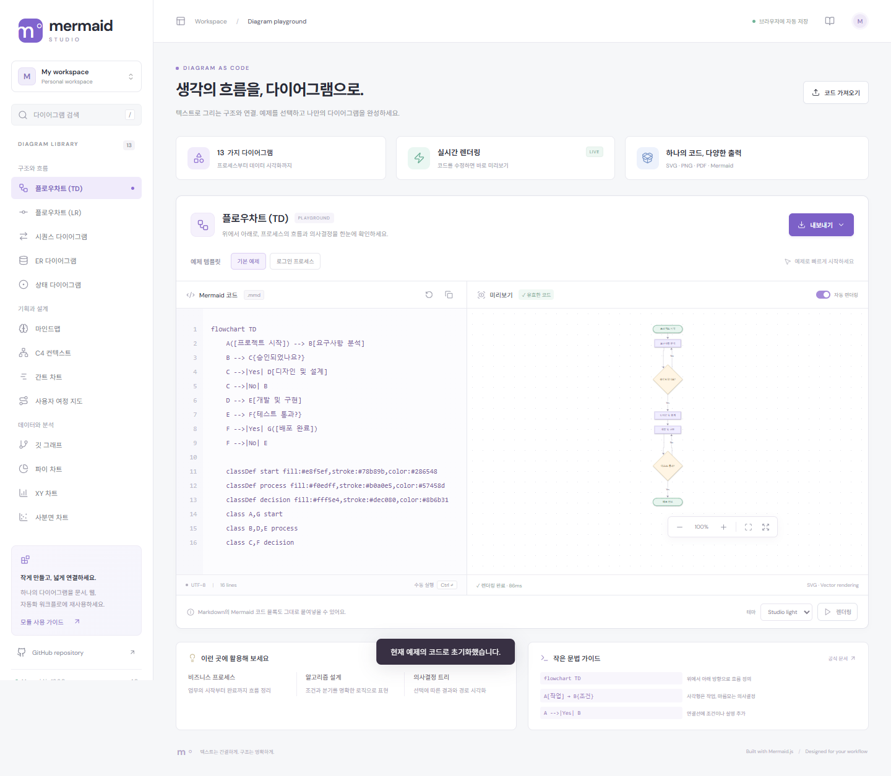

## 프로젝트 구조

```text
Mermaid.js-Module/
├── index.html              # 메인페이지와 편집기 화면
├── src/
│   ├── main.js             # 탐색, 편집, 자동 저장, 가져오기·내보내기
│   ├── catalog.js          # 13가지 다이어그램과 26개 예제
│   ├── renderer.js         # 구문 검증, SVG 렌더링, SVG·PNG 변환
│   └── style.css           # 데스크톱·모바일·인쇄 스타일
├── tests/
│   └── studio.spec.js      # 렌더링, PNG 다운로드, 복구·저장·모바일 테스트
├── docs/
│   ├── dashboard.png       # 데스크톱 화면
│   └── mobile.png          # 모바일 화면
├── vite.config.js          # 개발 서버 및 Mermaid ESM 배포 설정
├── playwright.config.js    # 개발·배포 모드 브라우저 테스트 설정
├── start-studio.cmd        # Windows 더블클릭 실행
├── package.json            # 의존성과 실행 명령
├── package-lock.json       # 의존성 버전 고정
├── mermaid_js_prd.md        # 제품 요구사항과 개발 로드맵
└── mermaidjs.png            # 디자인 참고 이미지
```

`index.html`에서 `main.js`를 실행하고, `catalog.js`의 예제를 편집기에 불러옵니다. 코드가 바뀌면 `renderer.js`가 Mermaid 구문을 검증한 뒤 SVG 미리보기를 갱신합니다. 오류가 있으면 마지막 정상 미리보기를 유지하며, 정상 결과는 SVG·PNG·Mermaid 파일 또는 브라우저 PDF 인쇄로 내보냅니다.

편집 내용과 테마는 브라우저의 `localStorage`에 저장합니다. 빌드 시에는 앱을 `dist/assets`에, Mermaid의 지연 로딩 모듈을 `dist/vendor/mermaid`에 생성합니다. `node_modules`, `dist`, 테스트 결과와 캐시는 Git에서 제외합니다.

## 실행

Node.js 22.12 이상에서 실행합니다.

```sh
npm ci
npm start
```

메인페이지가 기본 브라우저에서 자동으로 열립니다. 기본 주소는 `http://127.0.0.1:5173`이며, 이미 사용 중인 포트라면 터미널에 표시된 다음 포트를 사용합니다. 서버를 종료하려면 터미널에서 `Ctrl+C`를 누릅니다.

Windows에서는 프로젝트 폴더의 `start-studio.cmd`를 더블클릭해도 됩니다. 의존성이 없으면 설치하고 메인페이지를 엽니다. 실행 중에는 터미널 창을 열어 두세요. `index.html`을 직접 더블클릭하는 대신 이 실행 파일을 사용합니다.

브라우저를 자동으로 열지 않으려면 `npm run dev`를 실행합니다. 배포용 정적 파일은 `npm run build`로 생성되며, `npm run preview`로 확인할 수 있습니다. 배포 빌드는 Mermaid의 공식 ESM 분할 파일을 `dist/vendor/mermaid`에 포함해 필요한 기능을 로컬에서 불러옵니다. `dist` 폴더 전체를 함께 배포해야 합니다.

## 사용

- 왼쪽 라이브러리에서 13가지 다이어그램과 총 26개 예제를 선택합니다.
- Mermaid 원문 또는 Markdown의 첫 번째 Mermaid 코드 블록을 입력합니다. 자동 렌더링을 끄면 렌더링 버튼 또는 `Ctrl+Enter`로 실행합니다.
- 구문 오류가 발생하면 마지막 정상 미리보기를 유지합니다. 수정한 코드가 검증되면 내보내기가 활성화됩니다.
- SVG, PNG(최대 2배, 긴 변 최대 8,192px), Mermaid 원본을 다운로드합니다. PDF는 브라우저 인쇄 창에서 PDF 저장을 선택합니다.
- `.mmd`, `.md`, `.txt` 파일을 가져올 수 있습니다. 파일은 최대 200KB, 추출한 Mermaid 코드는 최대 50,000자입니다.
- 다이어그램별 편집 내용과 테마는 현재 브라우저의 로컬 저장소에 저장됩니다. 다른 기기로 옮기거나 보관하려면 파일로 내보내세요.

## 지원하는 13가지 다이어그램

앱의 라이브러리와 같은 순서로 정리했습니다. 플로우차트의 세로·가로 방향을 각각 포함한 13개 항목이며, 각 항목에 기본·응용 예제 2개씩 총 26개가 제공됩니다. 아래 Mermaid 예제는 `src/catalog.js`의 기본 예제와 동일합니다.

| # | 다이어그램 | 선언 구문 | 앱의 응용 예제 |
| --- | --- | --- | --- |
| 1 | [플로우차트 (TD)](#diagram-flowchart-td) | `flowchart TD` | 로그인 프로세스 |
| 2 | [플로우차트 (LR)](#diagram-flowchart-lr) | `flowchart LR` | CI/CD 파이프라인 |
| 3 | [시퀀스 다이어그램](#diagram-sequence) | `sequenceDiagram` | 결제 요청 |
| 4 | [ER 다이어그램](#diagram-er) | `erDiagram` | 블로그 스키마 |
| 5 | [상태 다이어그램](#diagram-state) | `stateDiagram-v2` | 신호등 |
| 6 | [마인드맵](#diagram-mindmap) | `mindmap` | 서비스 기획 |
| 7 | [C4 컨텍스트](#diagram-c4) | `C4Context` | 온라인 쇼핑몰 |
| 8 | [간트 차트](#diagram-gantt) | `gantt` | 콘텐츠 캘린더 |
| 9 | [사용자 여정 지도](#diagram-journey) | `journey` | 온라인 구매 여정 |
| 10 | [깃 그래프](#diagram-git) | `gitGraph` | 핫픽스 흐름 |
| 11 | [파이 차트](#diagram-pie) | `pie showData` | 트래픽 유입 |
| 12 | [XY 차트](#diagram-xy) | `xychart-beta` | 서비스 성장 |
| 13 | [사분면 차트](#diagram-quadrant) | `quadrantChart` | 업무 우선순위 |

<a id="diagram-flowchart-td"></a>

### 1. 플로우차트 (TD)

위에서 아래로, 프로세스의 흐름과 의사결정을 한눈에 확인하세요.

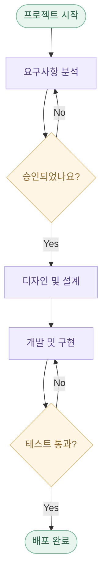

<a id="diagram-flowchart-lr"></a>

### 2. 플로우차트 (LR)

왼쪽에서 오른쪽으로 이어지는 파이프라인과 데이터 흐름을 표현하세요.

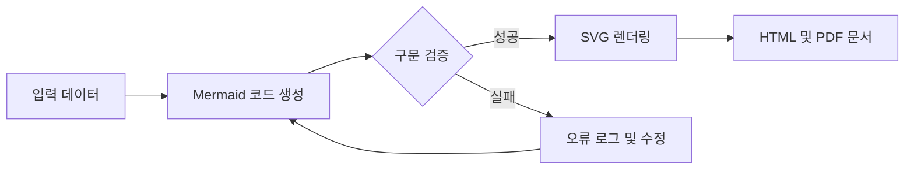

<a id="diagram-sequence"></a>

### 3. 시퀀스 다이어그램

시간의 순서에 따라 시스템 사이의 메시지와 상호작용을 표현하세요.

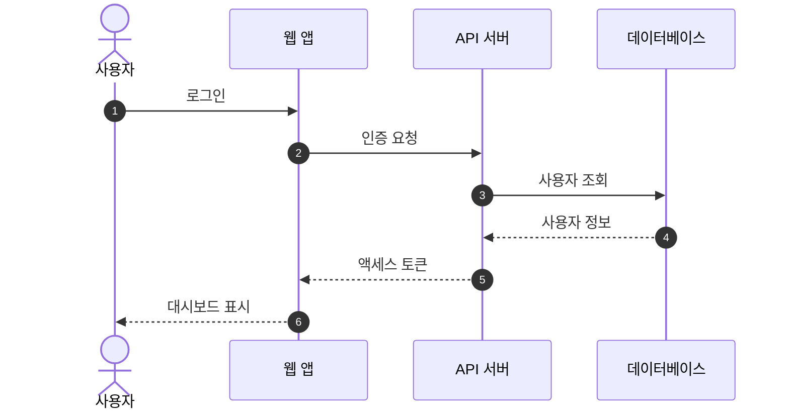

<a id="diagram-er"></a>

### 4. ER 다이어그램

테이블의 속성과 관계를 연결해 데이터베이스 구조를 설계하세요.

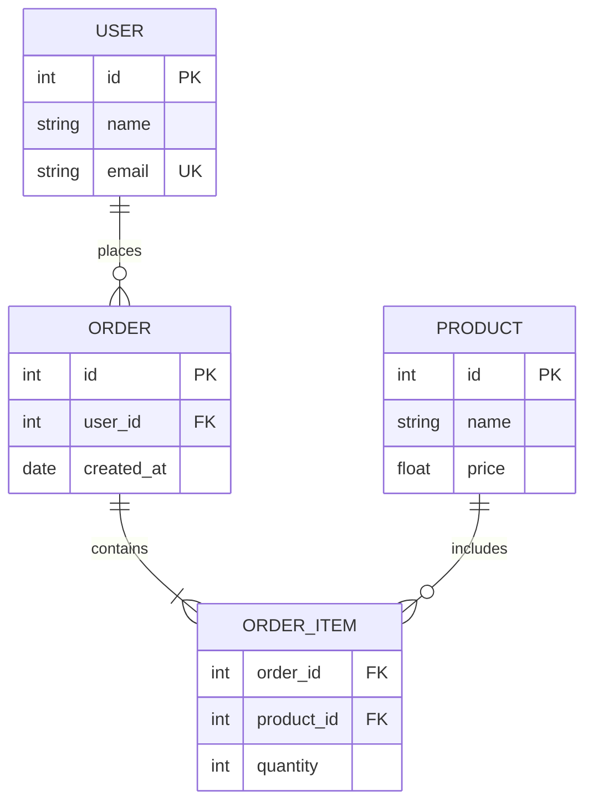

<a id="diagram-state"></a>

### 5. 상태 다이어그램

객체의 생명주기와 이벤트에 따른 상태 전환을 시각화하세요.

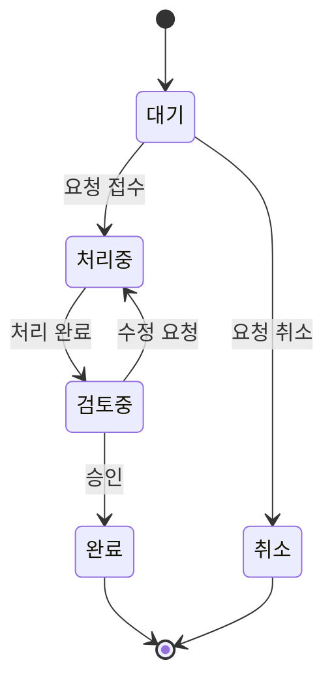

<a id="diagram-mindmap"></a>

### 6. 마인드맵

하나의 아이디어에서 뻗어 나가는 생각과 요구사항을 구조화하세요.

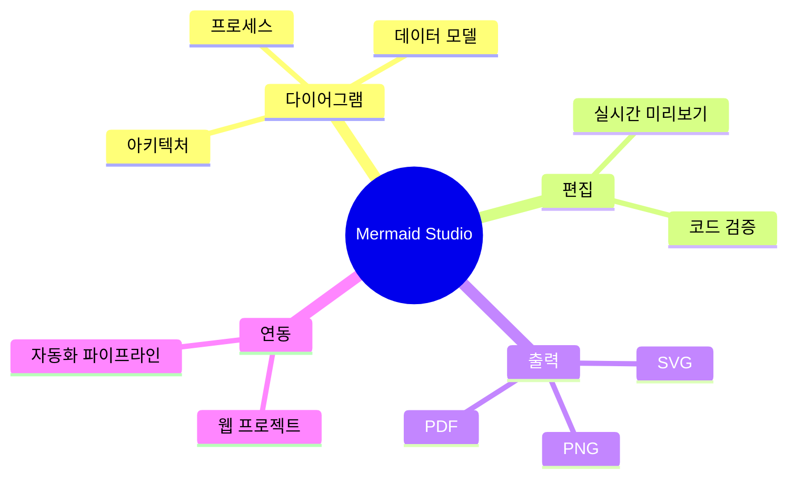

<a id="diagram-c4"></a>

### 7. C4 컨텍스트

사용자, 시스템, 외부 서비스의 관계로 아키텍처의 큰 그림을 그리세요.

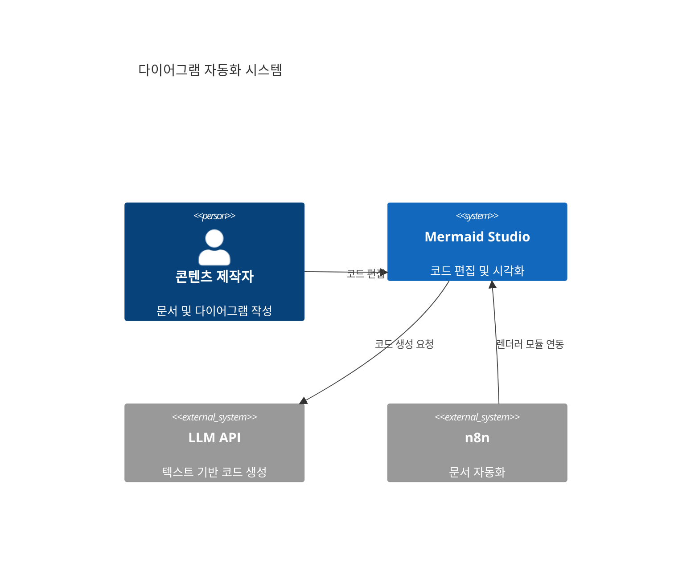

<a id="diagram-gantt"></a>

### 8. 간트 차트

작업 일정과 의존 관계를 시간축 위에 배치해 프로젝트를 계획하세요.

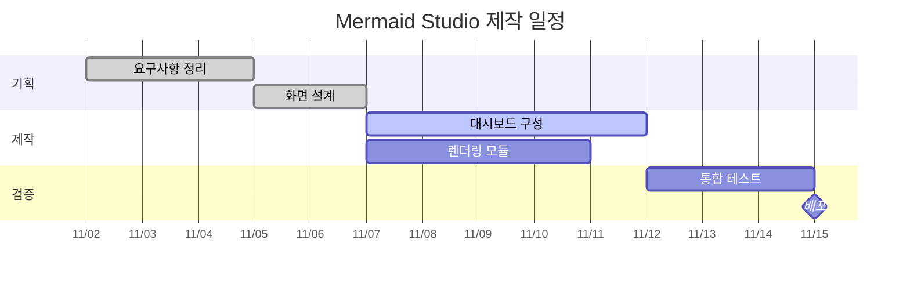

<a id="diagram-journey"></a>

### 9. 사용자 여정 지도

사용자의 단계별 경험과 감정을 따라 서비스의 개선점을 발견하세요.

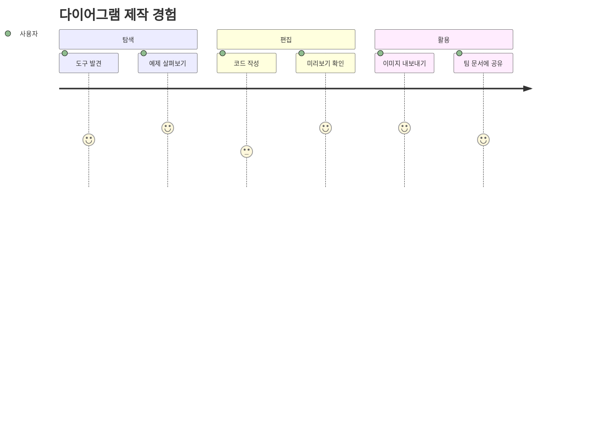

<a id="diagram-git"></a>

### 10. 깃 그래프

브랜치와 커밋, 병합으로 이어지는 버전 관리 히스토리를 표현하세요.

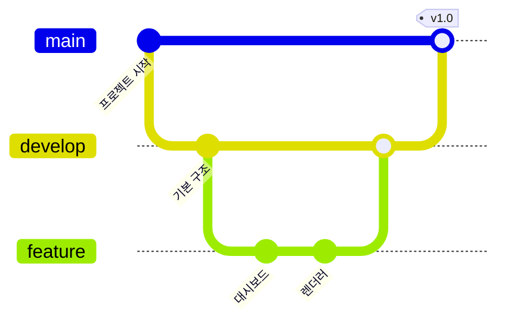

<a id="diagram-pie"></a>

### 11. 파이 차트

전체에서 차지하는 비중과 구성을 직관적으로 비교하세요.

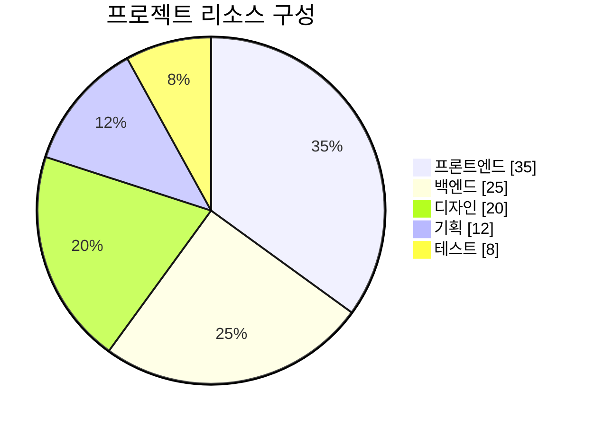

<a id="diagram-xy"></a>

### 12. XY 차트

수치의 변화와 추세를 막대·선 그래프로 함께 확인하세요.

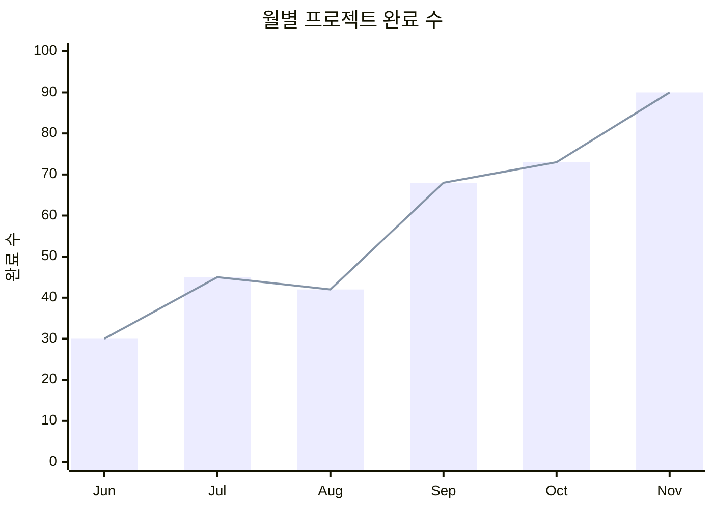

<a id="diagram-quadrant"></a>

### 13. 사분면 차트

두 가지 기준으로 항목을 배치해 우선순위와 포지셔닝을 비교하세요.

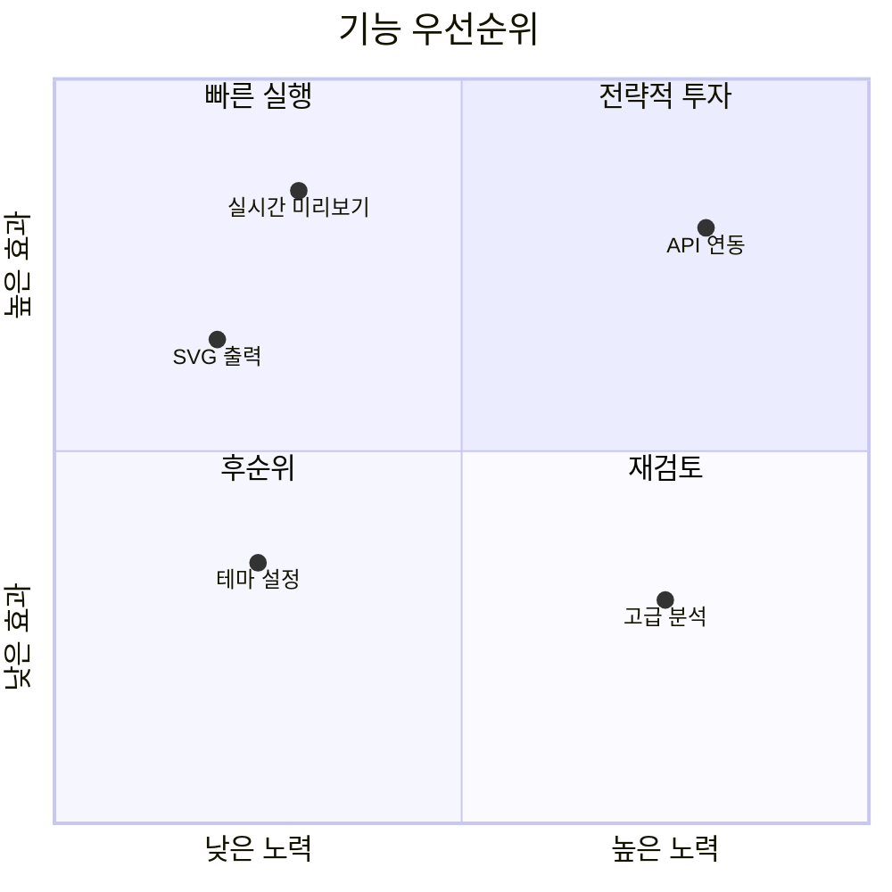

## 렌더러 재사용

번들러를 사용하는 브라우저 프로젝트에서 `mermaid` 의존성과 함께 가져옵니다.

```js
import { createDiagramRenderer } from './src/renderer.js';

const renderer = createDiagramRenderer();
try {
  const result = await renderer.render(
    document.querySelector('#preview'),
    'flowchart LR\n A[입력] --> B[결과]',
    { theme: 'studio' },
  );
  if (!result.stale) console.log(result.svg);
} catch (error) {
  console.error(error.message);
}
```

테마는 `studio`, `dark`, `forest`, `neutral`을 지원합니다. 렌더링 요청은 직렬 처리되며, 새 요청이나 `renderer.cancel()`로 대체된 요청은 `{ stale: true }`를 반환할 수 있습니다. 오류는 호출자에게 전달하고 기존 SVG는 유지합니다. `renderer.lastResult`로 마지막 정상 결과를 읽을 수 있습니다.

현재 구현은 브라우저용입니다. PRD의 서버 CLI, REST API, Claude 및 n8n 연동은 아직 구현되지 않았습니다. PDF 출력은 서버 변환 방식이 아닌 브라우저 인쇄 기능입니다.

## 검증

```sh
npm test
npm run build
```

배포 빌드를 테스트하려면 먼저 빌드한 뒤 PowerShell에서 `$env:STUDIO_TEST_PREVIEW='1'; npm test`를 실행합니다. 이후 개발 모드 테스트로 돌아갈 때는 `Remove-Item Env:STUDIO_TEST_PREVIEW`를 실행합니다.

Playwright 테스트는 설치된 Chrome을 사용합니다. 전체 예제 렌더링, 오류 복구, 로컬 저장, 수동 실행, 탐색, 가져오기, 파일 내보내기, 데스크톱·모바일 레이아웃을 확인합니다. 화면 캡처는 `docs/dashboard.png`, `docs/mobile.png`에 저장됩니다.
