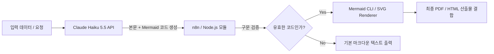

# [PRD] Mermaid.js 기반 시각화 자동화 모듈 (Diagram-as-Code Engine)

## 1. 개요 (Overview)
본 프로젝트는 텍스트(마크다운)와 데이터 기반으로 Mermaid.js 다이어그램을 자동 생성, 렌더링, 검증 및 시스템 산출물(PDF/HTML/Image)로 변환하는 독립형 **Mermaid 시각화 모듈**의 개발을 목표로 한다. LLM(Claude API) 및 n8n 자동화 파이프라인과의 매끄러운 연동을 지원하여 무인 문서화 및 콘텐츠 생성을 가능하게 한다.

---

## 2. 목적 및 배경 (Goals & Background)
- **개발 배경:** 외부 이미지 생성 AI의 텍스트 깨짐(Text Artifact) 현상 및 고비용 문제를 극복하고, 텍스트 기반 다이어그램 렌더링을 통한 한글 깨짐 원천 차단.
- **주요 목적:**
  - LLM이 출력한 Mermaid 구문을 파싱 및 유효성 검사(Validation)하여 예외 처리.
  - 마크다운 문서 및 자동화 파이프라인 내 인라인 시각화 지원.
  - 버전 관리가 가능한 텍스트 기반 산출물 생성 체계 구축.

---

## 3. 핵심 기능 요구사항 (Functional Requirements)

### 3.1. Mermaid 코드 파싱 및 검증 모듈 (Parser & Validator)
- **입력:** LLM 또는 사용자로부터 입력받은 텍스트 (Markdown 내 ` ```mermaid ` 블록 추출)
- **유효성 검사:**
  - Mermaid 구문 오류(Syntax Error) 감지 시 자동 롤백 및 에러 로그 생성.
  - 지원 다이어그램 패턴(Flowchart, Sequence, ERD, State, Mindmap, Gantt, User Journey, C4 등)의 예약어 검증.
- **유니코드 및 한글 보장:** UTF-8 인코딩 처리를 통해 한글 및 특수문자 깨짐 완전 방지.

### 3.2. 렌더링 및 출력 엔진 (Rendering Engine)
- **SVG / PNG / PDF 변환 지원:**
  - 웹 환경: 클라이언트 측 SVG 인라인 렌더링 (`mermaid.render()`).
  - 서버/CLI 환경: `@mermaid-js/mermaid-cli` (puppeteer 기반)를 활용한 서버 사이드 PNG/SVG/PDF 파일 익스포트.
- **해상도 및 반응형 제어:** SVG 고유의 벡터 방식을 유지하여 확대/축소 시 품질 저하 방지.

### 3.3. LLM & 파이프라인 연동 인터페이스 (API / Integration)
- **프롬프트 템플릿 제공:** Claude (Haiku 5.5 / Sonnet 5.5) 호환 구조화 JSON 및 Mermaid 다이어그램 동시 출력 프롬프트 규격화.
- **n8n / Node.js SDK 인터페이스:**
  - REST API 및 CLI 명령어로 입력 코드를 전달받아 변환 결과를 반환하는 마이크로서비스 형태.

---

## 4. 모듈 지원 다이어그램 사양 (Diagram Specs)

| 패턴 | 주요 코드 키워드 | 핵심 시각화 데이터 |
| :--- | :--- | :--- |
| **Flowchart** | `graph TD`, `flowchart LR` | 의사결정 트리, 프로세스 로직 분기 |
| **Sequence Diagram** | `sequenceDiagram` | 시간 순서별 API/객체 간 메시지 통신 |
| **ER Diagram** | `erDiagram` | DB 테이블 스키마, PK/FK 및 1:N 관계 |
| **State Diagram** | `stateDiagram-v2` | 시스템/객체 상태 및 상태 전환 조건 |
| **Mindmap** | `mindmap` | 계층 구조 아이디어 브레인스토밍 |
| **Gantt Chart** | `gantt` | 프로젝트 일정, 스프린트, 작업 의존성 |
| **User Journey Map**| `journey` | 사용자 단계별 경험 및 감정 변화 |
| **C4 Context** | `C4Context` | 고수준 소프트웨어 아키텍처 |

---

## 5. 비기능 요구사항 (Non-Functional Requirements)

- **성능 (Performance):** 1개 다이어그램당 서버 사이드 렌더링 처리 시간 1.5초 이내 완료.
- **유지보수성 (Maintainability):** 모듈 독립성을 보장하여 다른 Node.js, Python, n8n 환경에 패키지로 쉽게 임포트 가능하도록 구성.
- **안정성 (Reliability):** 구문 에러 발생 시 시스템 멈춤 방지(Graceful Fallback) 및 텍스트 원본 코드 대체 표기 기능 제공.

---

## 6. 사용 사례 및 아키텍처 흐름 (Workflow Architecture)



---

## 7. 마일스톤 및 개발 로드맵 (Milestones)

1. **Phase 1 (1주차):** Mermaid.js 핵심 파서 및 유효성 검사기 함수 모듈화.
2. **Phase 2 (2주차):** 서버 사이드(Node.js CLI) SVG/PNG 렌더러 구축.
3. **Phase 3 (3주차):** Claude API 및 n8n 파이프라인 연동 테스트.
4. **Phase 4 (4주차):** 예외 처리 강화 및 PDF/마크다운 최종 빌더 모듈 패키징.
